# 🛡️ Awesome Real-Time Threat Hunting & IOC Scanning 🔍

  <strong>Curated directory of real-time threat hunting platforms, automated indicator of compromise (IOC) scanners, YARA rule engines, threat intelligence platforms (TIP), and SOC defense tools.</strong>

  <a href="#-sector-overview--market-dynamics">Sector Overview</a> •
  <a href="#-saas--hosted-platforms">SaaS Platforms</a> •
  <a href="#-open-source-software">Open Source Tools</a> •
  <a href="#-feature-matrix">Feature Matrix</a> •
  <a href="#-key-selection-criteria">Selection Criteria</a> •
  <a href="#-star-history">Star History</a> •
  <a href="#-support--sponsor">Support</a> •
  <a href="#-contributing">Contributing</a>

---

## 📋 Table of Contents

- [🌐 Sector Overview & Market Dynamics](#-sector-overview--market-dynamics)
- [🏢 SaaS / Hosted Platforms](#-saas--hosted-platforms)
- [💻 Open-Source Software](#-open-source-software)
- [📊 Feature Matrix & Comparison](#-feature-matrix--comparison)
- [🎯 Key Selection Criteria](#-key-selection-criteria)
- [📈 Star History](#-star-history)
- [💖 Support & Sponsor](#-support--sponsor)
- [🤝 Contributing](#-contributing)
- [📄 License](#-license)

---

## 🌐 Sector Overview & Market Dynamics

The global threat hunting and threat intelligence platform (TIP) market is estimated at **$15B to $20B+** (with Threat Intelligence alone projected to reach ~$31B by 2030 at a 15–22% CAGR, and dedicated Threat Hunting scaling towards $14B–$18B+ at an ~18% CAGR). The market exhibits **moderate fragmentation**: high-scale platform conglomerates (Microsoft, CrowdStrike, SentinelOne) dominate holistic endpoint telemetry and SIEM/XDR data gravity, while an innovative and distributed ecosystem of specialized MDR vendors, autonomous hunting engines, and open-source intelligence repositories (MISP, Sigma, OpenCTI) address custom telemetry, adversary-specific hunts, and multi-cloud sovereignty.

---

## 🏢 SaaS / Hosted Platforms

Enterprise-grade, managed threat hunting and continuous IOC detection services. The table below is ordered by company valuation and enterprise market capitalization in descending order.

| 🏢 Platform | 💰 Company Valuation / Revenue | 🏷️ Starting Pricing Tier | 🎁 Free Tier / Trial Limit | 🎯 Core Threat Hunting Capabilities |
|---|---|---|---|---|
| **[Microsoft Defender Experts for Hunting](https://www.microsoft.com/en-us/security/business/services/microsoft-defender-experts-hunting)** | **$3.1T+ Valuation** (Microsoft Security revenue >$20B/yr) | Starting at **$3.00 to $4.00/user/month** add-on license (requires base prerequisite Microsoft 365 E5 or Defender for Endpoint Plan 2 at ~$57/user/month) | **30-day free trial** of Microsoft 365 E5 Enterprise Suite (covers up to 25 user licenses with full Defender XDR telemetry) | Proactive cross-domain hunting across endpoint, identity, Office 365 email, and cloud apps directly backed by Microsoft threat researchers. |
| **[CrowdStrike Falcon Overwatch](https://www.crowdstrike.com/products/threat-intelligence/falcon-overwatch-managed-threat-hunting/)** | **~$80B+ Market Cap** (~$3.9B ARR) | Starting at **$59.99/device/year** (Falcon Go tier); Falcon Enterprise / Overwatch tiers typically start at **$180+/device/year** depending on volume | **15-day free trial** of Falcon Prevent/Insight (up to 50 endpoints with full cloud dashboard access, no credit card required) | 24/7 human-in-the-loop managed adversary hunting combining Falcon telemetry, graph analytics, and real-time behavioral IOC hunting. |
| **[SentinelOne Singularity Threat Hunting](https://www.sentinelone.com/platform/singularity-threat-hunting/)** | **~$7.5B to $8.2B Market Cap** (~$1.15B ARR) | Singularity Core starts at **$70.00/endpoint/year**; Singularity Complete with deep threat hunting starts at **$180.00/endpoint/year** | **30-day proof-of-concept (PoC) evaluation** with full enterprise Singularity EDR/XDR suite access across designated test endpoints | Autonomous endpoint threat detection, Storyline distributed process correlation, and sub-second IOC query execution. |
| **[Rapid7 InsightIDR Threat Hunting](https://www.rapid7.com/products/insightidr/)** | **~$2.5B Market Cap** (~$800M ARR) | InsightIDR cloud SIEM starts at **$2,156/month** (billed annually for 500 assets, roughly **$4.31/asset/month**) | **30-day full-featured free trial** of InsightIDR (includes cloud ingestion, UEBA, prebuilt Sigma/YARA hunting rules, and log analytics) | Integrated cloud SIEM and proactive detection workflows pairing user and entity behavior analytics (UEBA) with network traffic analysis. |
| **[Druva Cyber Resiliency Threat Hunting](https://www.druva.com/solutions/threat-hunting)** | **~$2.0B Valuation** (~$250M+ ARR) | Data protection and resiliency suite starts at **$2.50 to $8.00/user/month** (or ~$0.08 to $0.15/GB/month depending on backup volume) | **30-day free trial** with up to 1 TB of cloud storage protection and complete ransomware anomaly and threat hunting scanner access | Out-of-band threat hunting through immutable cloud backups, preventing malware reinfection and identifying dormant IOCs prior to restoration. |
| **[Red Canary MDR Threat Hunting](https://redcanary.com/)** | **$675M Valuation** (Acquired by Zscaler in 2025; ~$140M+ ARR) | EDR-agnostic MDR starts at **$120.00/endpoint/year**, **$100.00/user/year**, and **$250.00/cloud resource/year** (volume discounts available) | **14-day guided sandbox PoC trial** with custom detection engineering assessment and active simulated telemetry ingestion | Human-driven managed detection engineering, continuous threat hunting mapped to MITRE ATT&CK, and transparent behavioral analysis. |

---

## 💻 Open-Source Software

Community-governed, self-hosted IOC matching engines, signature databases, and threat hunting platforms. Sorted by GitHub stargazer count in descending order.

| 💻 Repository | ⭐ GitHub_Stars | 📜 License | 🛠️ Architecture / Stack | 🎯 Target Hunting Focus |
|---|---|---|---|---|
| **[SigmaHQ/sigma](https://github.com/SigmaHQ/sigma)** |  | Open Source | YAML Rules / pySigma Python engine | Generic, vendor-agnostic signature format for SIEM & log systems with 3,000+ threat hunting rules. |
| **[OpenCTI-Platform/opencti](https://github.com/OpenCTI-Platform/opencti)** |  | Apache-2.0 | TypeScript / GraphQL / Elastic / Redis | Unified enterprise cyber threat intelligence platform for managing, structuring, and hunting IOCs/TTPs. |
| **[VirusTotal/yara](https://github.com/VirusTotal/yara)** |  | BSD-3-Clause | C / Python bindings | The de facto industry-standard pattern matching Swiss Army knife for binary inspection and IOC file hunting. |
| **[MISP/MISP](https://github.com/MISP/MISP)** |  | AGPL-3.0 | PHP / MySQL / Python (PyMISP) | Core open-source threat sharing platform for IOC aggregation, automated correlation, and community feeds. |
| **[Yara-Rules/rules](https://github.com/Yara-Rules/rules)** |  | GPL-2.0 | YARA Signature Sets | Massive community repository of curated YARA rules for malware classification, ransomware, and memory scans. |
| **[TheHive-Project/TheHive](https://github.com/TheHive-Project/TheHive)** |  | AGPL-3.0 | Scala / Play / Cassandra / Elasticsearch | Scalable Security Incident Response Platform (SIRP) closely linked with MISP and Cortex for IOC case handling. |
| **[Neo23x0/Loki](https://github.com/Neo23x0/Loki)** |  | GPL-3.0 | Python / YARA / MD5-SHA256 hashes | Simple, portable IOC and incident response scanner matching YARA rules, hashes, filenames, and C2 IPs. |
| **[Neo23x0/signature-base](https://github.com/Neo23x0/signature-base)** |  | CC-BY-NC-4.0 | YARA / IOC Signatures / Regex | Comprehensive signature database containing thousands of IOCs, YARA rules, and hash databases for DFIR scans. |
| **[TheHive-Project/Cortex](https://github.com/TheHive-Project/Cortex)** |  | AGPL-3.0 | Scala / Python analyzers | Automated observable analysis and active response engine querying 100+ threat intelligence services. |
| **[Neo23x0/Fenrir](https://github.com/Neo23x0/Fenrir)** |  | GPL-3.0 | Bash / Posix shell | Simple, ultra-lightweight Bash IOC scanner for Unix/Linux systems requiring zero third-party dependencies. |
| **[cisagov/ioc-scanner](https://github.com/cisagov/ioc-scanner)** |  | CC0-1.0 | Python | Official CISA lightweight file-system scanner for searching endpoints and servers for designated IOCs. |
| **[kavat/anubi](https://github.com/kavat/anubi)** |  | GPL-3.0 | Python / YARA / SQLite | Portable hash and YARA scanner with layer-4 network monitoring and daily threat feed updating. |
| **[paman7647/TraceForge](https://github.com/paman7647/TraceForge)** |  | MIT License | Python / Go / SQLite | Local-first CLI toolkit for DFIR analysts; performs IOC extraction, defanging, evidence hashing, and STIX export. |

---

## 📊 Feature Matrix & Comparison

| Solution | Deployment | Real-Time Telemetry | IOC Ingestion | Custom Hunting Rules | Automated Enrichment | Incident Response Integration |
|---|---|---|---|---|---|---|
| **Microsoft Defender Experts** | SaaS Cloud | ✅ Streaming XDR | ✅ Cloud Sync | ✅ KQL Hunting | ✅ Native Graph | ✅ Auto-Remediation |
| **CrowdStrike Falcon Overwatch** | SaaS Cloud | ✅ Kernel Agent | ✅ Threat Graph | ✅ Falcon Fusion | ✅ CrowdStrike Intel | ✅ Real-Time Response |
| **SentinelOne Singularity** | SaaS Cloud | ✅ Real-time Storyline | ✅ Deep Visibility | ✅ STAR Engine | ✅ Autonomous Context | ✅ 1-Click Rollback |
| **Rapid7 InsightIDR** | SaaS Cloud | ✅ Log Streaming | ✅ Threat Feeds | ✅ Attacker Behavior | ✅ Insight Platform | ✅ Automation Workflows |
| **Druva Threat Hunting** | SaaS Cloud | ✅ Backup Telemetry | ✅ Backup Hashes | ✅ Ransomware Signatures | ✅ Air-gapped Metadata | ✅ Quarantine & Clean Restore |
| **Red Canary** | SaaS MDR | ✅ Multi-EDR Telemetry| ✅ Cloud Sync | ✅ Custom Behavioral | ✅ Human Analyst Intel | ✅ Coordinated Response |
| **MISP** | Self-Hosted | ❌ Batch Feeds | ✅ Deep Correlation | ❌ Attribute Store | ✅ PyMISP Integrations | ⚠️ Via TheHive/SIEM |
| **OpenCTI** | Self-Hosted | ⚠️ Event Bus | ✅ STIX2 Standards | ✅ Rule Engine | ✅ Connectors Ecosystem | ⚠️ Via Case Templates |
| **Sigma** | Self-Hosted | ❌ Rule Spec | ❌ Query Syntax | ✅ Universal Rules | ❌ Rule Catalog Only | ⚠️ Export to SIEM |
| **VirusTotal/YARA** | CLI / Lib | ❌ Filesystem Scan | ✅ Binary Signatures | ✅ Complex Matching | ❌ Standalone Library | ⚠️ Integrable with EDR |
| **TheHive & Cortex** | Self-Hosted | ❌ SOC Ingestion | ✅ Observables DB | ❌ Workflow Logic | ✅ 100+ Cortex Analyzers| ✅ Full SIRP Workflow |
| **Neo23x0 Loki / Fenrir** | Host CLI | ❌ Point-in-time | ✅ Local IOC DB | ✅ YARA & Hash Rules | ❌ Offline Execution | ❌ Manual Triage |

---

## 🎯 Key Selection Criteria

When building a modern threat hunting and IOC scanning capability, consider the following trade-offs:

1. **Detection Speed & Telemetry Gravity:** Kernel-level streaming agents (CrowdStrike, SentinelOne) provide real-time behavioral telemetry, whereas open-source tools like Loki and Fenrir are ideal for scheduled compromise assessments or incident response triage where agents cannot be deployed.
2. **Rule Portability vs. Proprietary Query Languages:** Using vendor-neutral formats such as **Sigma** and **YARA** prevents lock-in to proprietary SIEM syntax (like KQL or SPL) and enables seamless sharing across collaborative defensive alliances.
3. **Intelligence Sharing Standards:** Systems adopting **STIX 2.1** and **MISP data models** (such as OpenCTI and MISP) streamline interoperability between intelligence producers, threat sharing ISACs, and downstream defense platforms.
4. **Air-Gapped & Backup Scanning:** Resiliency tools like **Druva** inspect secondary snapshot storage out-of-band to catch dormant persistence mechanisms without creating production endpoint overhead.

---

## 📈 Star History

---

## 💖 Support & Sponsor

Thank you so much for exploring and using this collection! Maintaining comprehensive cybersecurity threat hunting resources takes continuous research, curation, and verification.

If you find this repository valuable, please consider supporting the project:
- ⭐ **Star this repository** on GitHub to help others discover it!
- 🍴 **Fork it** and contribute new tools, IOC feeds, or hunting rules.
- 📢 **Share it** with fellow SOC analysts, detection engineers, and infosec communities on LinkedIn, X/Twitter, or Reddit.
- ☕ **Buy me a coffee / Sponsor:** Support ongoing open-source curation directly through the [GitHub Sponsors Dashboard](https://github.com/sponsors/ishandutta2007).

---

## 🤝 Contributing

Contributions are warmly welcomed! To contribute:

1. 🍴 Fork this repository.
2. 🌿 Create your feature branch (`git checkout -b feature/cool-hunting-tool`).
3. 📝 Add the project following our tabular or bulleted format with verified repository links, licensing, and capabilities.
4. 🚀 Commit your changes (`git commit -m 'Add Awesome New IOC Scanner'`).
5. 📤 Push to the branch (`git push origin feature/cool-hunting-tool`).
6. 🎯 Open a Pull Request!

---

## 📄 License

This collection is distributed under the [Creative Commons Zero v1.0 Universal License (CC0-1.0)](https://creativecommons.org/publicdomain/zero/1.0/). Listed commercial products and open-source tools remain copyrighted under their respective creators and proprietary/open-source licenses.

---

  Built with ❤️ for cybersecurity analysts, SOC operators, and detection engineers worldwide.

